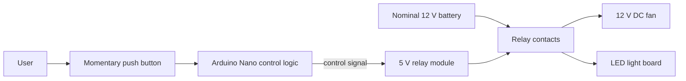

# Power Latch

*A Design Thinking and electronics-prototyping project exploring simple control of everyday DC appliances.*

> **Project status: Design and prototyping.** The project direction, component identification, circuit representations and an initial Wokwi layout are documented. The available project record does **not** yet verify a complete working physical prototype, final firmware, or end-to-end test results.

## Overview

Power Latch explores a low-cost way to control a 12 V DC fan and an LED light board using an **Arduino Nano**, a **5 V two-channel relay module**, and a **momentary push button** for manual interaction. The intended load supply is a battery labelled 12 V, 12000 mAh.

The work combines Design Thinking with electronics prototyping: framing a user problem, exploring alternative concepts, selecting accessible components, drawing circuit representations, experimenting in Wokwi, and planning physical implementation.

## At a glance

| Item | Current project direction |
|---|---|
| Project type | Design Thinking + electronics prototyping |
| Controller | Arduino Nano clone |
| Switching | Two-channel 5 V relay module; exact board behaviour/rating to verify |
| Input | Momentary tactile push button |
| Intended loads | 12 V DC fan and LED light board |
| Intended load supply | Battery labelled 12 V, 12000 mAh |
| Simulation | Initial Wokwi layout with Nano-style board, relay, servo and LED |
| Firmware | Initial sketch only; complete tested firmware not established |

## Problem being explored

This project explores whether a simple microcontroller-and-relay arrangement can provide a practical, affordable alternative to repeated manual appliance switching while retaining a physical control option.

**Working problem framing (hypothesis, not validated research):** People who want a simple and affordable way to control everyday appliances may benefit from a microcontroller-based controller that preserves manual interaction.

The available project record does not establish completed interviews, surveys or structured observations. Claims about user behaviour, cost savings or energy savings should therefore remain hypotheses until supported by evidence.

## Design principle

**Automation should not remove the user's ability to intervene manually.** The momentary push button is included to explore manual override. Its exact behaviour—toggle, force a state, or temporarily override—has not yet been finalized or validated.

## Conceptual system architecture

This is a conceptual architecture, not a verified wiring diagram. The final circuit must confirm whether the fan and light are switched together or independently. The battery powers the intended loads; it is not the relay module's 5 V control supply.

## Design Thinking process

| Stage | Current documentation |
|---|---|
| Empathize | Potential user groups and needs identified as hypotheses; formal research not documented |
| Define | A simple, affordable appliance-control need framed |
| Ideate | Manual, app/IoT, timer, sensor and Arduino/relay approaches discussed |
| Prototype | Components identified, circuit representations discussed/created, initial Wokwi layout started |
| Test | Test plan proposed; completed end-to-end results not available |

See [Design Thinking process](docs/design-thinking-process.md).

## Hardware identified

- Arduino Nano clone.
- Two-channel relay module; blue relays marked `JQC3F-05VDC-C`, with control labels `VCC`, `GND`, `IN1`, `IN2`.
- Battery labelled 12 V, 12000 mAh, with DC barrel-style output.
- 12 V DC fan.
- LED light board (full electrical rating not documented).
- Momentary tactile push button.
- Small perfboard (approximately 2 × 8 cm) and connecting wires.

See [hardware inventory](docs/hardware-inventory.md) and [bill of materials](hardware/bill-of-materials.md). Component availability does not establish that the complete circuit has been assembled or tested.

## Simulation and firmware

An initial Wokwi layout has been described with an Arduino Nano-style board, relay, servo and LED. The servo is a visual stand-in for fan behaviour in the simulation; it is not electrically equivalent to a continuously rotating DC fan. A complete tested sketch and shareable Wokwi link have not been established.

See [simulation and firmware notes](docs/simulation-and-firmware.md). The `src/arduino/` folder is a placeholder until the actual sketch is available and reviewed.

## Implementation status

| Work item | Status based on available project notes |
|---|---|
| Project direction and intended loads | Established |
| Physical components identified in project photographs | Evidence of components available |
| Relay and push-button representations | Discussed/created |
| Wokwi layout | Started; successful run not established |
| Arduino firmware | Initial sketch only; complete tested firmware not established |
| Final physical wiring / soldered perfboard | Not confirmed |
| End-to-end operation of both loads | Not confirmed |
| Manual-override behaviour | Not finalized or tested |
| User validation and measured energy savings | Not documented |

“Not confirmed” means the available project record does not establish completion; it does not prove the work has never been done.

## Testing

No completed test log is available in the project summary. A test plan and record template are provided in [Testing and results](docs/testing-and-results.md).

## Safety

Battery and motor circuits can cause overheating, short circuits or damage if wired incorrectly. Verify battery polarity and actual voltage with a multimeter; do not infer polarity from wire colour. Keep the 12 V load path separate from the 5 V relay-control supply. Do not use an Arduino GPIO pin to power a real fan or other load. Verify relay contact ratings against each load's operating and startup current, and use appropriate protection, insulation and strain relief. This documentation does not establish that the design has been safety-tested. Do not connect mains voltage as part of this prototype without a properly engineered, rated and safely enclosed design and qualified supervision.

## Repository structure

- `docs/` — Design Thinking process, system design, hardware, simulation, testing and next steps.
- `hardware/` — Preliminary bill of materials.
- `simulation/` — Wokwi documentation.
- `diagrams/` — Circuit-diagram placeholders.
- `assets/` — Component and prototype-photo placeholders.
- `src/arduino/` — Firmware placeholder.
- `testing/` — Test evidence and records.

## Next steps

1. Add the actual circuit diagram and original component/prototype photographs.
2. Finalize and explain manual-override behaviour.
3. Confirm relay trigger polarity, wiring and electrical ratings.
4. Complete the Wokwi model and add its share link, if available.
5. Add the real Arduino sketch once complete and tested.
6. Record physical tests with expected result, actual result, date and supporting evidence.
7. Add genuine user research or clearly retain the problem framing as a hypothesis.

## License

No license is included yet. Decide how you want others to reuse the documentation, diagrams and code before adding one. Public visibility does not by itself grant permission to reuse the work.
