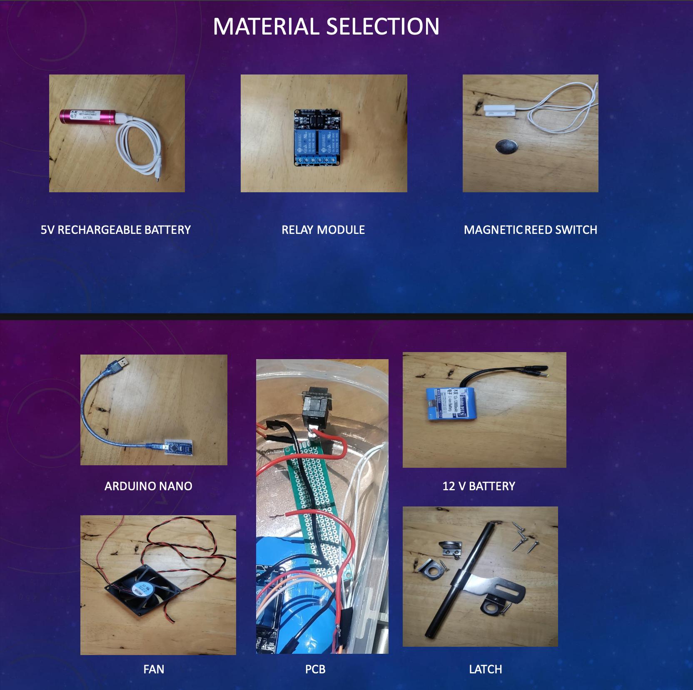

# Power Latch

*A Design Thinking and electronics-prototyping project for latch-triggered appliance control.*

> **Prototype status:** A working low-voltage demonstration has been reported and a demo video is available. The intended application is room AC appliance control, but no 220–240 V mains-connected implementation or safety verification is claimed.

## Overview

Power Latch explores switching room appliances based on the locked/unlocked state of a door or latch. A magnet moves relative to a magnetic reed switch; an Arduino Nano reads the sensor and controls a relay module. A push button provides a temporary manual override.

The intended application is controlling AC supply lines for room appliances such as fans and lights. For the course demonstration, the team used a **12 V DC fan and an LED light board** rather than connecting the prototype to mains voltage.

## Confirmed workflow

1. The Arduino Nano and control circuit are powered.
2. A magnet's position relative to the magnetic reed switch changes when the door/latch state changes.
3. The reed switch signal is read by the Arduino on **D3**.
4. The Arduino processes the sensor state.
5. The Arduino controls the relay module through **D5 / IN1**.
6. The relay switches the connected load circuit. In the demonstrated behaviour, locking the room turns the fan and light **OFF**; unlocking the room turns them **ON**.
7. A push button on **D11** temporarily overrides the automatic control.

The fan and light are controlled together, according to the project team's description of the demonstration. The precise timeout/condition for ending the temporary override should be documented from the actual firmware.

## At a glance

| Item | Details |
|---|---|
| Project type | Design Thinking + electronics prototyping |
| Controller | Arduino Nano |
| Sensor | Magnetic reed switch, D3 |
| Relay control | Relay module IN1, D5 |
| Manual input | Momentary push button, D11 |
| Demonstrated control | Lock = fan/light OFF; unlock = fan/light ON |
| Manual override | Temporary override; exact resume condition to document |
| Demonstration loads | 12 V DC fan and LED light board |
| Intended application | AC-powered room appliances such as fans and lights |
| Relay markings/specification provided | 5 V DC coil; contacts stated as 10 A, 250 V AC / 30 V DC |
| Evidence | Material-selection image and linked working demonstration video |

## Prototype evidence

### Material selection

The image below shows the components selected for the project.

### Working demonstration

[Watch the Power Latch prototype demonstration on YouTube](https://youtu.be/SxAZail_Stw)

The demonstration uses low-voltage loads (12 V DC fan and LED light board); it does not demonstrate a connection to AC mains.

See [prototype evidence](assets/prototype/README.md) for the media index.

## Intended application vs. demonstrated prototype

The 12 V DC demonstration shows the control concept only. It is **not** a mains installation and does not prove the complete relay module, circuit layout, enclosure or wiring is safe for a particular AC appliance. Although the stated contact rating is 10 A, 250 V AC / 30 V DC, the exact module, load category, motor-starting current, isolation, creepage/clearance, enclosure, wiring, protection and local electrical requirements must be reviewed by a qualified person before any mains application. Do not connect this prototype to mains voltage as an experiment.

## Design Thinking process

| Stage | Current evidence/status |
|---|---|
| Empathize | Potential user needs have been discussed; formal interviews/surveys are not yet documented here. |
| Define | The project explores convenient appliance control linked to securing a room. |
| Ideate | Alternative approaches were considered in the project work; the Arduino/reed-switch/relay direction was selected. |
| Prototype | Physical components and a low-voltage working demonstration are reported; material-selection evidence is included above. |
| Test | A demo video is linked above; a structured test log and measurements remain to be documented. |

See [Design Thinking process](docs/design-thinking-process.md), [system design](docs/system-design.md), [hardware inventory](docs/hardware-inventory.md), and [testing and results](docs/testing-and-results.md).

## Hardware identified

- Arduino Nano.
- Magnetic reed switch and magnet.
- 5 V two-channel relay module, with relays marked `JQC3F-05VDC-C`.
- Momentary push button.
- Battery labelled 12 V, 12000 mAh for the demonstration loads.
- 12 V DC fan and LED light board.
- Perfboard/PCB assembly, connecting wires, and latch hardware.
- A separate 5 V rechargeable battery is also shown on the material-selection slide; its exact role in the final circuit needs confirmation.

## Current limitations

- The final firmware/source code has not yet been added to this repository.
- The exact logic that ends the temporary manual override needs documenting from the code.
- The actual circuit diagram still needs to be added.
- No mains-connected build, mains test, formal electrical safety review, measured energy savings or formal user validation is claimed.

## Safety

Keep the low-voltage control and load circuits correctly separated. Confirm supply polarity, relay input polarity, load current and motor startup current before testing. A relay rating alone does not establish that a complete mains installation is safe. Any mains design must be appropriately rated, enclosed, protected and reviewed/implemented by a qualified person.

## Repository structure

- `docs/` — Design Thinking process, system design, hardware, simulation and testing.
- `hardware/` — Preliminary bill of materials.
- `assets/components/` — Component reference images.
- `assets/prototype/` — Material-selection image and demonstration-video link.
- `src/arduino/` — Firmware.
- `simulation/` — Simulation notes.
- `testing/` — Test records and evidence.

## Next steps

1. Add the final report and use it to strengthen the Design Thinking-stage documentation.
2. Add the final circuit diagram and Arduino code.
3. Document the temporary override's exact resume condition.
4. Record repeatable low-voltage test results.
5. Treat AC implementation as a separate engineering and safety-validation task.

## License

No license is included yet. Choose a license before inviting others to reuse the code or documentation.