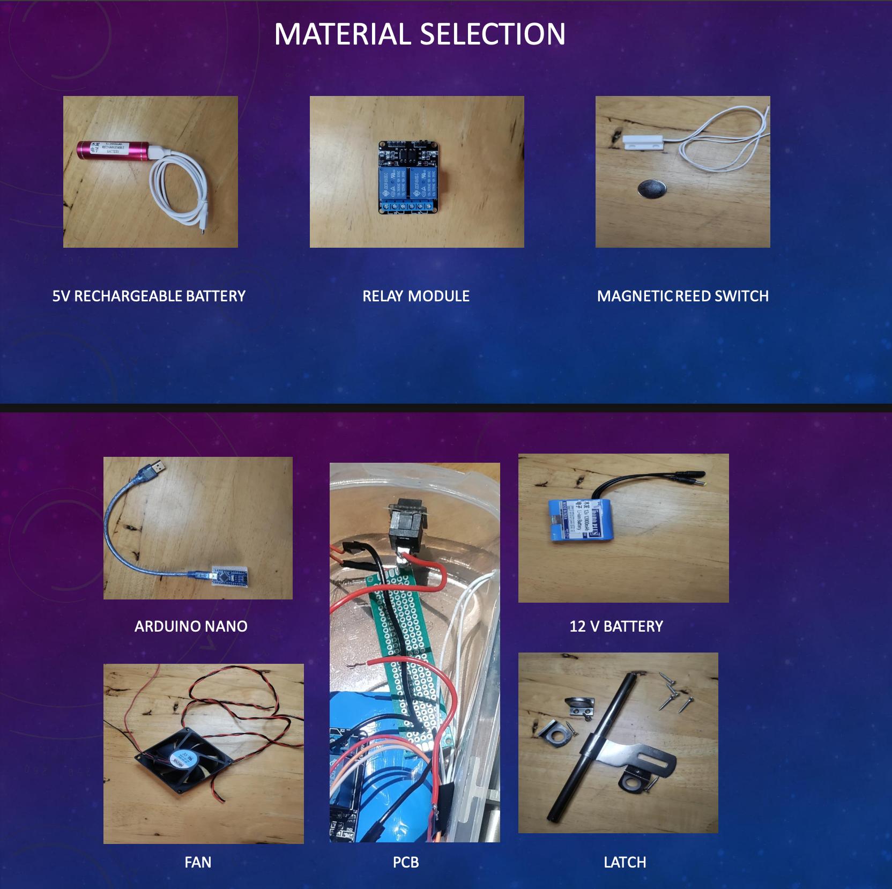

# Prototype Evidence

This folder contains the material-selection image and links to the working Power Latch demonstration.

## Material selection

The slide identifies the 5 V rechargeable battery, relay module, magnetic reed switch, Arduino Nano, 12 V battery, fan, PCB/perfboard assembly and latch hardware. The exact role of the 5 V rechargeable battery in the final circuit still needs confirmation.

## Working demonstration

[Watch the Power Latch prototype demonstration on YouTube](https://youtu.be/SxAZail_Stw)

The demonstration video is hosted externally; it is not stored as a binary file in this repository. The demonstration uses a 12 V DC fan and LED light board and does not show a mains-connected implementation.

See [working-demo-link.md](working-demo-link.md) for the video reference.