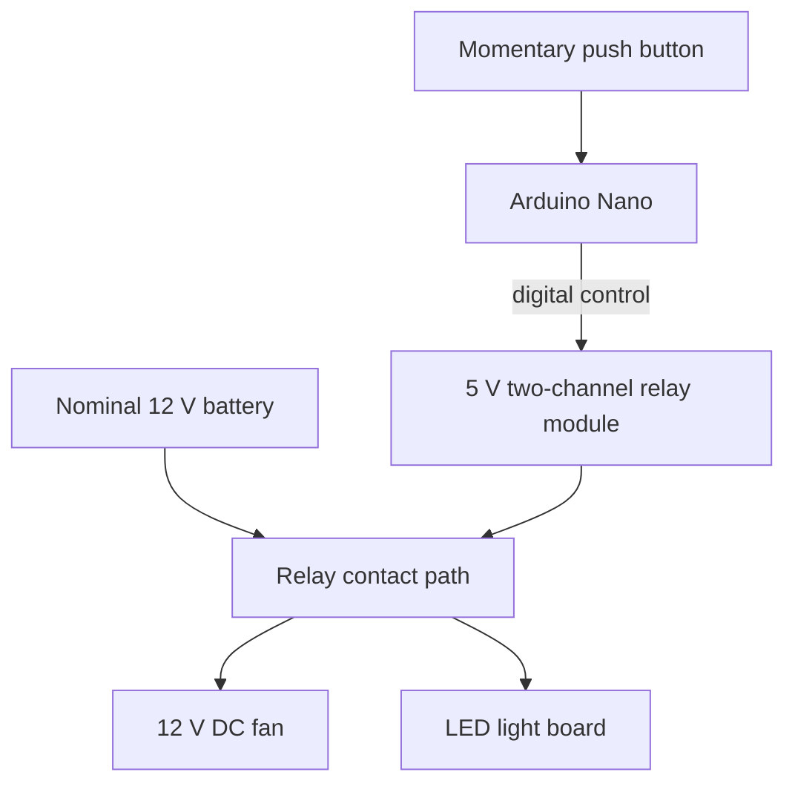

# System Design

## Purpose

Explore a simple controller for a 12 V DC fan and an LED light board, using an Arduino Nano, relay-based switching and a momentary push button for manual interaction.

## Conceptual architecture

This diagram expresses functional blocks only. It is not a pin-accurate wiring schematic and does not define the final contact arrangement.

## Control side and load side

**Control side:** Arduino Nano clone, two-channel 5 V relay module, momentary tactile push button and appropriate regulated supply arrangement.

**Load side:** Battery labelled 12 V, 12000 mAh; 12 V DC fan; LED light board (full voltage/current specification not established); relay contacts and load wiring.

The control supply and load supply are distinct. The 12 V battery is intended for the loads; do not connect it to the relay module's 5 V `VCC` input. The exact arrangement for powering the Arduino and relay module must be confirmed from the actual board and final circuit.

## Relay module interface identified

Control-side labels: `VCC`, `GND`, `IN1`, `IN2`. Contact-side labels: `COM1`, `NO1`, `NC1`, `COM2`, `NO2`, `NC2`.

For a typical changeover relay, COM connects to NO when energized and to NC when de-energized. Confirm this against the module datasheet and continuity measurements before wiring. The exact input polarity is unresolved; some boards are active-low.

The blue relays on the photographed module were marked `JQC3F-05VDC-C`. The available notes do not establish the complete module's contact-current rating, isolation arrangement or trigger polarity.

## Open architecture decisions

1. Will one relay channel switch the fan and light together, or will separate channels control them independently?
2. What exact behaviour should the momentary button produce?
3. What, if anything, initiates automatic operation?
4. What regulated supply arrangement powers the Arduino and relay module?
5. What are the fan and LED board's measured/labelled operating currents?
6. What protection is required for the battery, wiring and inductive motor load?

## Diagram accuracy

A relay symbol for an OMRON G8N-1H-AS DC12 bare relay was also discussed. Do not present that bare relay symbol as though it were the complete photographed two-channel 5 V relay module. Label diagrams clearly so readers can distinguish the bare relay component from the relay module.
