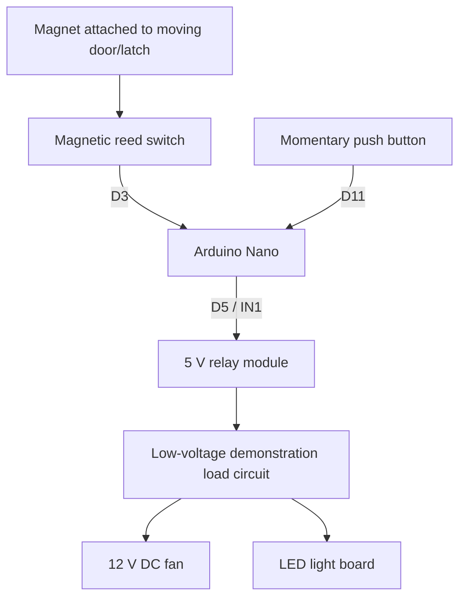

# System Design

## Purpose

Power Latch is intended to control room AC appliance circuits based on the locked/unlocked state of a door or latch. The physical demonstration used a 12 V DC fan and an LED light board instead of connecting the prototype to 220–240 V mains.

## Functional architecture

This is a functional block diagram, not a pin-accurate wiring schematic. The relay switches the separate load circuit; Arduino GPIO pins must not power the fan or light directly.

## Operating sequence

1. **Initialization:** Arduino Nano and control electronics receive their required supply.
2. **Latch-state sensing:** The magnet moves relative to the reed switch as the door/latch is secured or released.
3. **Input reading:** The reed switch is connected to D3 and GND according to the presentation. With `INPUT_PULLUP`, a closed switch to GND normally reads LOW; firmware must match the actual sensor arrangement.
4. **Decision:** The Arduino interprets the sensor state as locked or unlocked.
5. **Relay command:** The Arduino drives relay input IN1 from D5. Confirm the actual module's trigger polarity; relay boards may be active-low.
6. **Load switching:** In the described demonstration behaviour, locking turns the fan and light OFF, while unlocking turns them ON. The two demonstration loads are controlled together.
7. **Manual override:** The momentary push button connects to D11 and GND. It temporarily overrides automatic control. The exact condition that ends the override and resumes automatic behaviour should be verified against the final firmware/demo.

## Pin summary

| Component | Connection | Function |
|---|---|---|
| Magnetic reed switch | D3 and GND | Detect door/latch state |
| Relay module IN1 | D5 | Control the load switching relay |
| Momentary push button | D11 and GND | Temporary manual override |
| Relay module supply | VCC and GND | Module control supply; verify board requirements |

## Demonstration vs intended application

**Demonstrated:** low-voltage DC fan and LED light board powered from the demonstration setup.

**Intended:** switching AC mains supply lines to room appliances such as fans and lights.

The working low-voltage demonstration does not verify a mains-connected design. The relay contact rating provided by the team is 10 A, 250 V AC / 30 V DC, but this rating alone does not establish suitability for a motor load or the safety of the complete module and installation. Before any mains application, a qualified person must verify the exact module and datasheet, load category and inrush, isolation, PCB creepage/clearance, enclosure, conductor ratings, overcurrent protection and applicable local requirements. Do not experiment with exposed mains wiring.

## Open implementation details

- Confirm the precise reed-switch contact behaviour and firmware state mapping.
- Document the override duration/termination condition from the actual firmware.
- Add the final circuit schematic and Arduino source.
- Confirm the 5 V rechargeable battery's role, if it was part of the final circuit.
- Record measured current and supply details for the 12 V demonstration loads.