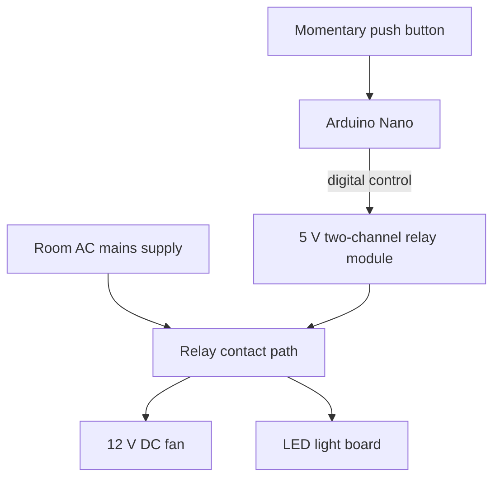

# System Design

## Purpose

The intended system is a controller for high-voltage AC supply lines feeding room appliances such as fans and lights. The course prototype demonstrated the control concept using a 12 V DC fan and LED light board as safer low-voltage presentation loads, avoiding a 220 V mains connection in the hostel room.

## Conceptual architecture

This diagram expresses the intended functional concept and separately indicates the low-voltage demonstration. It is not a pin-accurate wiring schematic, a mains wiring instruction, or evidence of a mains-connected build.

## Control side and load side

**Control side:** Arduino Nano clone, two-channel 5 V relay module, momentary tactile push button and appropriate regulated supply arrangement.

**Intended load side:** Room AC supply circuits for loads such as fans and lights.\n\n**Demonstration load side:** Battery labelled 12 V, 12000 mAh; 12 V DC fan; LED light board. These low-voltage loads were used for the course presentation in place of a 220 V mains connection.

The control supply and load supply are distinct. The 12 V battery powered the low-voltage demonstration loads; do not connect it to the relay module's 5 V `VCC` input. The exact arrangement for powering the Arduino and relay module must be confirmed from the actual board and final circuit.

## Relay module interface identified

Control-side labels: `VCC`, `GND`, `IN1`, `IN2`. Contact-side labels: `COM1`, `NO1`, `NC1`, `COM2`, `NO2`, `NC2`.

For a typical changeover relay, COM connects to NO when energized and to NC when de-energized. Confirm this against the module datasheet and continuity measurements before wiring. The exact input polarity is unresolved; some boards are active-low.

The blue relays on the photographed module were marked `JQC3F-05VDC-C`. The available notes do not establish the complete module's contact-current rating, isolation arrangement or trigger polarity.

## Mains application: important qualification\n\nThe intended application involves switching AC mains circuits, but the available project evidence covers only the 12 V DC demonstration. A relay's contacts may be rated for AC switching, but suitability cannot be assumed from the relay name or from successful DC operation. Verify the exact module's AC voltage/current ratings, load category and inrush capacity, isolation, PCB creepage/clearance, enclosure, conductor sizing, overcurrent protection and applicable local electrical requirements. A design intended for mains must be reviewed and implemented by a suitably qualified person. Do not connect the prototype to 220 V mains as an experiment.\n\n## Open architecture decisions

1. Will one relay channel switch the fan and light together, or will separate channels control them independently?
2. What exact behaviour should the momentary button produce?
3. What, if anything, initiates automatic operation?
4. What regulated supply arrangement powers the Arduino and relay module?
5. What are the fan and LED board's measured/labelled operating currents?
6. What protection is required for the battery, wiring and inductive motor load?

## Diagram accuracy

A relay symbol for an OMRON G8N-1H-AS DC12 bare relay was also discussed. Do not present that bare relay symbol as though it were the complete photographed two-channel 5 V relay module. Label diagrams clearly so readers can distinguish the bare relay component from the relay module.
